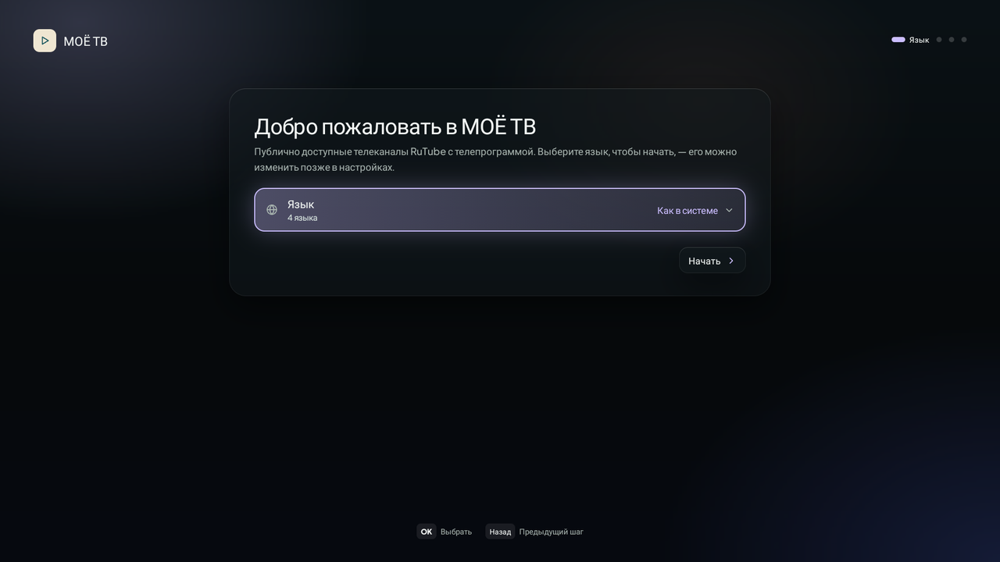
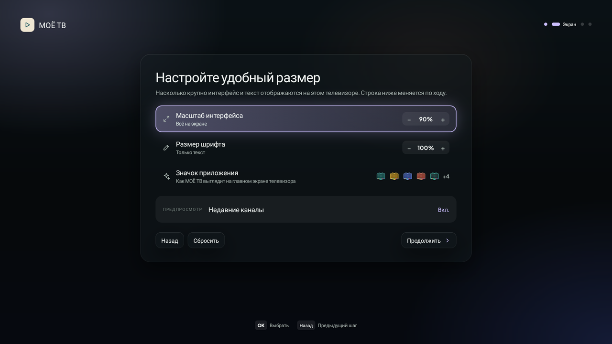
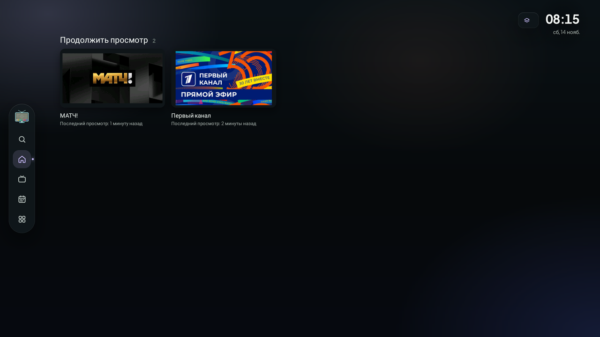
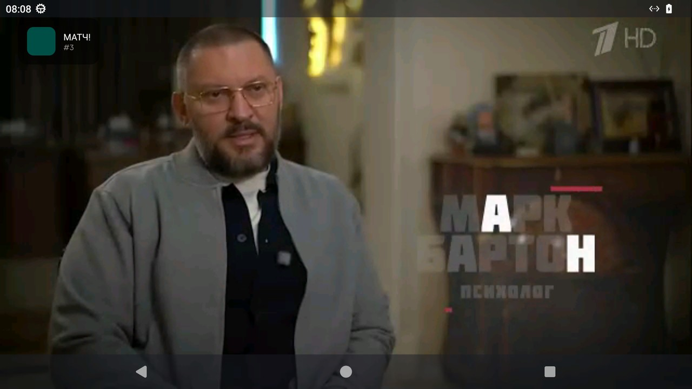
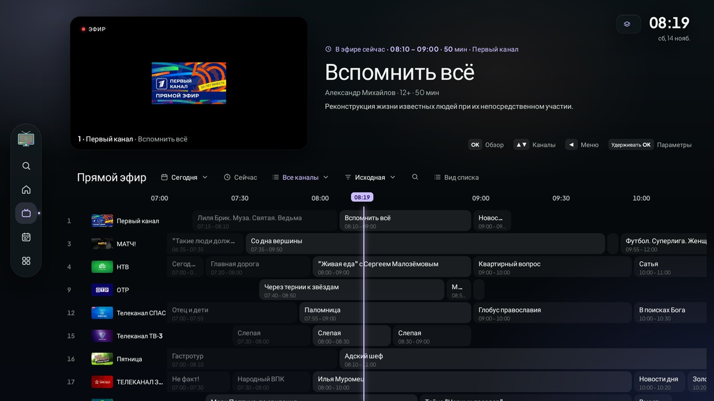
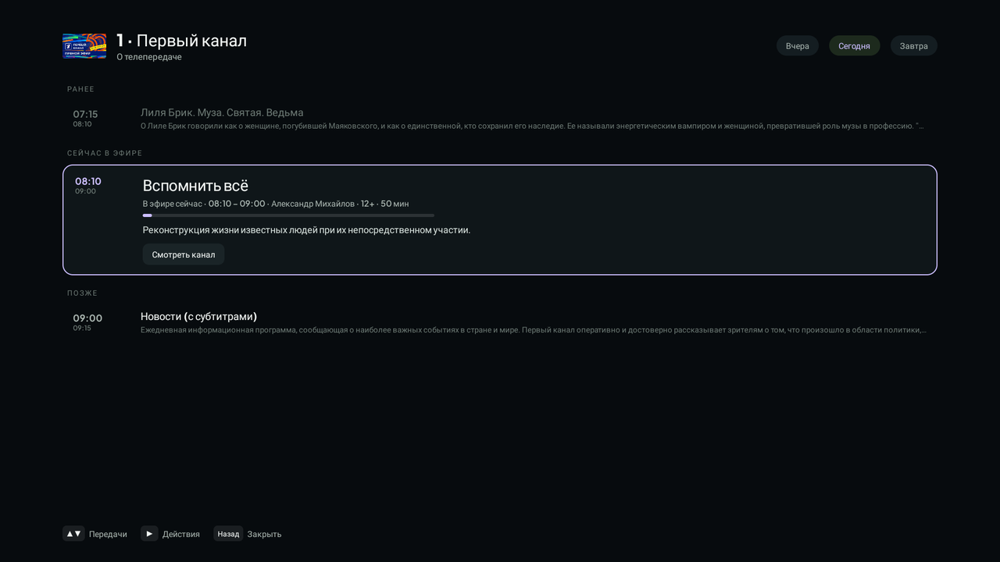
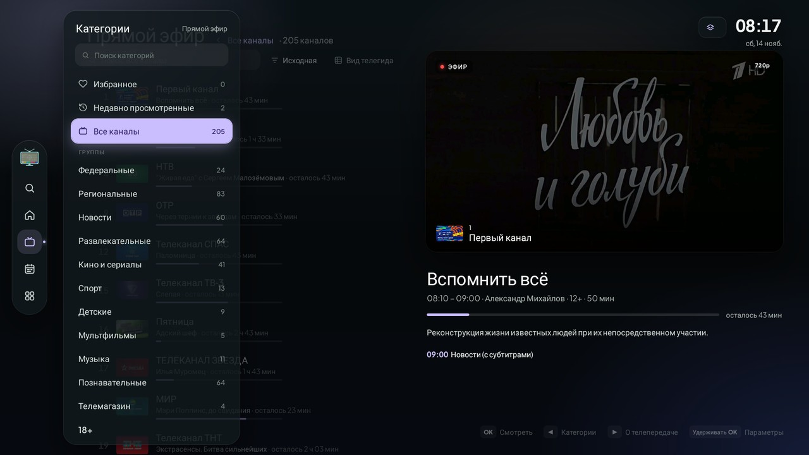
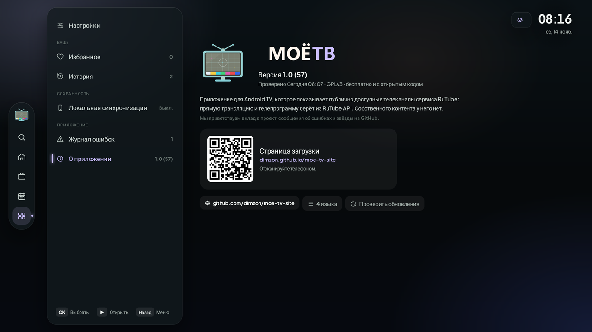

<p align="center">
  <picture>
    <source media="(prefers-color-scheme: light)" srcset="extras/brand/app-logos/logo_eggshell_light.png">
    
  </picture>
</p>

<p align="center">
  <b>МОЁ ТВ / MyOwnTV — плеер прямого эфира RuTube для Android TV</b><br>
  <sub>Быстро · современно · пульт прежде всего — публичный каталог эфира и программа передач, без плейлистов и логинов</sub>
</p>

<p align="center">
  
  
  
  
  
  
</p>

---

МОЁ ТВ / MyOwnTV — нативный **плеер прямого эфира** для **Android TV** на Kotlin и Jetpack
Compose for TV. Эфир воспроизводится через **ExoPlayer (Media3)**, переключение каналов почти
мгновенное. Это **только плеер**: список каналов и программа передач приходят из **публичного API
RuTube** — плейлисты и логин не нужны, а первый запуск сводится к выбору языка, размера интерфейса
и политики обновления.

> ⚠️ МОЁ ТВ **не поставляет** собственных каналов, плейлистов, подписок и потоков. Приложение
> воспроизводит публично доступные эфиры RuTube. Ответственность за то, что вы смотрите, и за
> соблюдение применимых законов и прав лежит на вас.

Открытый исходный код, **GPL-3.0-only**, создано с помощью ИИ. **Только Android TV** — leanback-лаунчер,
навигация пультом (D-pad). **Это производная работа**, а не оригинальный OwnTV — см. ниже.

<a id="screenshots"></a>

---

## 📸 Скриншоты

Снято на Android 13 (redroid, 1920×1080), версия 1.0. На экранах с видео — живой эфир RuTube.

| | |
|:---:|:---:|
|  |  |
| **Первый запуск** — язык, масштаб интерфейса | **Размер** — масштаб и шрифт |
|  |  |
| **Главная** — «Продолжить просмотр» | **Прямой эфир** — список и живое превью |
|  |  |
| **Эфир** — полноэкранное воспроизведение | **Телегид** — эфир в виде сетки |
|  |  |
| **Телегид** — программа передач на день | **Передача** — описание и расписание канала |
|  |  |
| **Категории** — группы каналов с количеством | **Поиск** — по каналам и передачам |
|  |  |
| **Настройки** — все разделы в одном месте | **О приложении** — версия и ссылки |

Полный набор, включая журнал ошибок и разделы настроек, — в каталоге
[docs/screenshots](docs/screenshots).

<a id="origins"></a>

---

## 🧬 Происхождение и атрибуция

**МОЁ ТВ / MyOwnTV — существенно изменённая версия
[OwnTV](https://github.com/ahXN00/OwnTV)** авторства **ahXN00 и участников OwnTV**, распространяемая
под **GNU General Public License версии 3 только** (`GPL-3.0-only`). Снимок апстримовой ветки
`main` импортирован **2026-11-09** (сразу после апстримового v5.2.1 от 2026-10-21) как корневой
коммит этого репозитория `214719f`; история апстрима в точке ответвления схлопнута.

Также использован код **[OwnTV_Core](https://github.com/ahXN00/OwnTV_Core)** (тоже
`GPL-3.0-only`), включённый в `app/src/main/java/tv/own/owntv/**`: база данных, синхронизация,
парсеры, EPG и движок воспроизведения, **а также переведённые строки интерфейса** (апстрим
поставлял 26 локалей, этот форк — четыре: английскую, русскую, украинскую и белорусскую).
Документация и инструменты i18n тоже унаследованы; апстримная айдентика сохранена в
`extras/brand/legacy/`, а актуальный кит МОЁ ТВ собран в `extras/brand/`; эталонные Workers для
TMDB/OpenSubtitles (`extras/worker/`) и их логотипы удалены в этом форке (коммит `cf8b0b5`).
Полное юридическое уведомление: [NOTICE](NOTICE).

> **THIS IS A SUBSTANTIALLY MODIFIED VERSION OF OwnTV / Это существенно изменённая версия OwnTV.**
> Изменения вносятся с **2026-11-09** Дмитрием Александровым (dimzon). Copyright (C) 2026 Dmitry
> Alexandrov — на изменения и дополнения; исходные части остаются © ahXN00 и участников OwnTV.
> Это выделенное уведомление об изменении, требуемое GPLv3 §5(a).

Что изменилось:

- **Только прямой эфир RuTube** — каталог каналов и недельная программа передач приходят из
  публичного API RuTube; провайдеры Xtream / M3U / Stalker и их модель источников удалены.
- **Один движок воспроизведения** — mpv / libmpv / FFmpeg убраны, остался только ExoPlayer
  (Media3). Удалены VOD (фильмы/сериалы), трейлеры, catch-up, загрузки, профили и экран
  файлового бэкапа (`ec31209`); схема базы под live-only пересобиралась неоднократно (v4–v8).
- **Внешние сервисы метаданных удалены** — интеграции TMDB и OpenSubtitles, их эталонные Workers
  (`extras/worker/`), логотипы и API-ключи (`cf8b0b5`), сопоставление каналов с EPG и сравнение
  «Sources» в плеере (`4a962f9`). Неиспользуемая зависимость `android-youtube-player` ушла вместе
  с кодом трейлеров.
- **Четыре языка** — апстрим поставлял 26 переводов, форк упаковывает английский, русский,
  украинский и белорусский (`a1d246c`). Кредиты апстрима сохранены в `NOTICE`.
- **Ребрендинг** — логотип МОЁ ТВ, иконки и баннер лаунчера,
  `applicationId com.github.dimzon.owntv`, deep links `moetv://`; актуальный бренд-кит лежит в
  `extras/brand/` (генераторы — `tools/brand/` и `extras/branding/`).
- Апстримовые скриншоты в `extras/screenshots/` и исторические заметки о релизах в
  `CHANGELOG.md` сохранены для провенанса; часть из них изображает функции, которых в форке нет.
  Актуальные скриншоты форка — в `docs/screenshots/` и в разделе «Скриншоты» выше.

МОЁ ТВ / MyOwnTV **не аффилировано, не одобрено, не спонсируется и не связано** с оригинальным
проектом OwnTV, ahXN00 или его участниками. Название «OwnTV» используется здесь исключительно для
обозначения работы, от которой произошёл форк. Полный список ссылок и текстов, всё ещё указывающих
на апстрим (и ожидающих URL репозитория форка), — в
[docs/attribution-checklist.md](docs/attribution-checklist.md).

<a id="features"></a>

---

## ✨ Возможности

### 🎬 Воспроизведение
- **ExoPlayer (Media3)** — единственный движок, заточенный под мгновенное переключение каналов
- **4K HDR** без промежуточной обработки, необязательное автосогласование частоты кадров для эфира
  (с предупреждением для Android до 12), объёмный звук, усиление громкости до 150%
- **Субтитры** — настройка вида (масштаб, шрифт, цвет, положение, фон) для дорожек, которые
  предоставляет сам поток
- Мини-плеер / PiP (картинка в картинке по нажатию Home), режим «только звук», оверлей с
  информацией о потоке
- Кнопки медиасессии и корректный audio focus — ведёт себя как настоящее ТВ-приложение

### 📺 Прямой эфир и программа
- **Каталог эфира RuTube** — публичный список (~200 каналов) с категориями, логотипами и
  уточнёнными названиями для одноимённых брендов
- **Программа, которая не пропадает** — расписание RuTube на неделю вперёд загружается по дням и
  обновляется через upsert, поэтому неудачное обновление не стирает уже сохранённое
- «Сейчас» и «далее» везде, плюс напоминания о передачах

### 📚 Медиатека и персонализация
- Избранное, категории, скрытие каналов, поиск с экранной клавиатурой
- PIN-код на категории и четыре языка интерфейса (английский, русский, украинский, белорусский) —
  профилей больше нет

<a id="tech"></a>

## 🧱 Технологии

| Область | Технология |
|------|--------|
| Язык | Kotlin 2.4.20 |
| Сборка | AGP 9.4.0 / Gradle 9.8.2, KSP2, JDK 25 |
| UI | Jetpack Compose for TV (`androidx.tv:tv-material`), Compose BOM 2026.08.00 |
| Медиа | **ExoPlayer/Media3** |
| База данных | Room + Paging + FTS4 |
| DI · сеть · изображения | Koin · OkHttp · Coil |

`minSdk 26`, `targetSdk 36`, `applicationId com.github.dimzon.owntv` (Kotlin namespace
`tv.own.myowntv`).

### Структура проекта

```
MyOwnTV/  (этот репозиторий)
tv.own.myowntv/
├── player/      HUD плеера для ТВ, поверхности и мини-плеер
├── ui/          тема и переиспользуемые компоненты
├── features/    live, epg, home, more, search, settings, setup, shell, customize,
│                pip, multiview, categorylock, autostart, recovery, update
└── di/          Koin-модули
```

База данных, синхронизация, парсеры, хранилище EPG и движок прямого эфира находятся в этом же
модуле под `tv/own/owntv/**` — одно дерево исходников, никакой отдельной библиотеки подтягивать
не нужно.

Контракт API RuTube, правила для каналов и EPG, устройство базы и перечень нативных библиотек
описаны в [docs/rutube.md](docs/rutube.md).

<a id="install"></a>

## 📥 Установка (Fire TV / Android TV)

**Где релизы:** страница загрузки — <https://dimzon.github.io/moe-tv-site/>, сами APK —
раздел **Releases** публичного репозитория **<https://github.com/dimzon/moe-tv-site/releases>**
(код-репозиторий приватный, релизы публикуются в site-репозиторий).

1. Скачайте APK со страницы загрузки или из Releases, либо соберите из исходников, как описано ниже.
2. Установите: на Fire TV через приложение **Downloader**, в остальных случаях — с USB-накопителя,
   через *Send files to TV* или `adb install MoeTV_<версия>_universal.apk`.

> Каждый релиз содержит **один универсальный APK** `MoeTV_<версия>_universal.apk` — arm64-v8a,
> armeabi-v7a и x86_64 в одном файле, подходит и приставкам, и эмуляторам.
> Встроенная проверка обновлений («Настройки → О приложении → Проверить обновления») читает
> последний релиз именно из `dimzon/moe-tv-site`.

<a id="build"></a>

## 🛠️ Сборка и запуск

Сборка — **только батниками** из корня репозитория и **только флейвор `universal`** (все ABI в одном
APK):

- `build-debug.cmd universal` — debug-сборка;
- `build-release.cmd universal` — release-сборка (R8, подпись из `keystore.properties`);
- `publish.cmd <версия> [notes.md]` — release-сборка + публикация релиза `v<версия>` в
  `dimzon/moe-tv-site` + обновление версии на странице загрузки.

Задачи `assemble*` через `gradlew` напрямую не запускать; флейворы `standard`, `x86_64` и `all` не
собирать. Минимум — **Android 8.0 / API 26**; APK окажется в `app/build/outputs/apk/universal/`.
Для запуска из Android Studio выберите вариант `universalDebug`.

## 🤝 Как участвовать

Приветствуются правки, сообщения об ошибках и идеи — заводите issue или pull request. Пожалуйста,
сохраняйте позиционирование проекта как «только плеер» и следуйте принятому стилю кода.
Пользовательская и контрибьюторская документация ведётся **по-русски** — подробности в
[CONTRIBUTING.md](CONTRIBUTING.md).

## 🙏 Благодарности

### 🌍 Переводы

Апстрим поставлял 26 локалей; этот форк упаковывает английский, русский, украинский и белорусский,
остальные деревья остались в репозитории апстрима. Большинство тех переводов сделано волонтёрами
на [Hosted Weblate](https://hosted.weblate.org/projects/owntv/), который бесплатно предоставляет
хостинг свободному ПО. Английские и русские строки пришли из
[OwnTV_Core](https://github.com/ahXN00/OwnTV_Core); украинский и белорусский переводы добавлены в
этом форке. Спасибо Weblate и всем переводчикам.

### 🎨 Бренд

Логотип **owntv** строчными буквами нарисован для OwnTV
[@m3th0d93](https://github.com/m3th0d93) в [issue #227](https://github.com/ahXN00/OwnTV/issues/227);
апстримная айдентика сохранена в `extras/brand/legacy/` и остаётся © её авторов. Актуальный
бренд-кит **МОЁ ТВ** — в `extras/brand/`, его генераторы — `tools/brand/` и `extras/branding/`;
это собственная работа этого форка.

### ▶️ Воспроизведение

- **[Media3 / ExoPlayer](https://github.com/androidx/media)** — единственный движок, для прямого
  эфира и HLS (Apache-2.0).
- **mpv / libmpv / FFmpeg** питали второй движок в апстримовом OwnTV; **в этом форке они больше не
  поставляются**. Исторические кредиты сохранены в [NOTICE](NOTICE) и
  [CHANGELOG.md](CHANGELOG.md).

### 🛰️ Сторонние сервисы

- **TMDB** — апстримовый OwnTV использовал [TMDB](https://www.themoviedb.org/) для метаданных и
  трейлеров; **этот форк удалил интеграцию** и эталонный Worker. Запросов к TMDB нет.
- **OpenSubtitles** — апстримовый OwnTV использовал
  [OpenSubtitles](https://www.opensubtitles.com/) для поиска субтитров; **этот форк удалил
  интеграцию**, эталонный Worker и встроенный логотип. Запросов к OpenSubtitles нет.

### 🧩 Используемые библиотеки

[Jetpack Compose for TV](https://developer.android.com/jetpack/compose) ·
[Room](https://developer.android.com/jetpack/androidx/releases/room) ·
[Koin](https://insert-koin.io/) ·
[OkHttp](https://square.github.io/okhttp/) ·
[Coil](https://coil-kt.github.io/coil/) ·
[ZXing](https://github.com/zxing/zxing) — и более широкий open-source мир Kotlin / AndroidX.
Спасибо всем их мейнтейнерам. Все лицензии, уведомления об авторских правах и встроенные ассеты
перечислены в [THIRD_PARTY_LICENSES.md](THIRD_PARTY_LICENSES.md).

<a id="legal"></a>

## ⚖️ Правовая информация

МОЁ ТВ — это **только медиаплеер** и неофициальный клиент: оно не аффилировано, не одобрено и не
связано с RuTube (ООО «Руформ»), с оригинальным проектом
[OwnTV](https://github.com/ahXN00/OwnTV) и с любыми другими сервисами. Названия и логотипы
«RuTube», «OwnTV», «TMDB», «OpenSubtitles» и прочие принадлежат их владельцам и используются
только для описания происхождения и совместимости. Приложение не поставляет собственных каналов
и не поощряет и не облегчает доступ к несанкционированным трансляциям.

<a id="license"></a>

## 📄 Лицензия

**GNU General Public License, версия 3 только (`GPL-3.0-only`)** — см. [LICENSE](LICENSE)
(неизменённый текст GPLv3), [NOTICE](NOTICE) (атрибуция и уведомление об изменении) и
[THIRD_PARTY_LICENSES.md](THIRD_PARTY_LICENSES.md).

Это **модифицированная версия OwnTV**, изменяемая с **2026-11-09** (GPLv3 §5(a)). Как того требует
§5(c), **вся** производная работа — и унаследованные части, и дополнения форка — лицензирована под
GPLv3. Дополнительные условия §7 не добавляются. Апстрим опубликовал GPLv3 без оговорки «or later»,
поэтому здесь не предлагается никакая более поздняя версия.

Коротко: вы свободно используете, изучаете, изменяете и распространяете МОЁ ТВ, в том числе
коммерчески, — но любая распространяемая версия (включая форки и коммерческие продукты на её
основе) тоже должна быть под GPLv3, сохранять все уведомления об авторских правах и атрибуцию и
предоставлять полные **Соответствующие исходники (Corresponding Source)** (§6). **ГАРАНТИИ НЕТ** —
см. §§15–16 [LICENSE](LICENSE).

**Соответствующие исходники:** полное дерево исходников, из которого собрана ваша копия, включая
`LICENSE`, `NOTICE`, `THIRD_PARTY_LICENSES.md`, тексты лицензий шрифтов OFL и Gradle-скрипты
сборки. Публичного репозитория у форка пока нет; если вы получили только бинарную сборку, запросите
исходники у того, кто её распространил. Перед публикацией APK пройдите
[чек-лист атрибуции](docs/attribution-checklist.md).

---

<sub>МОЁ ТВ / MyOwnTV — открытый исходный код, только плеер, создано с помощью ИИ. Существенно
изменённая производная работа OwnTV (© ahXN00 и участники OwnTV, GPL-3.0-only); изменения
© 2026 Дмитрий Александров, GPL-3.0-only.</sub>
