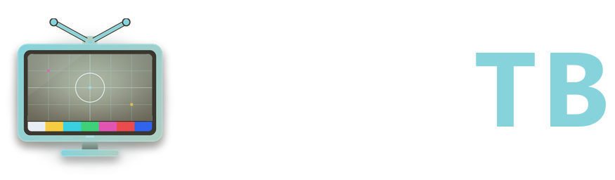
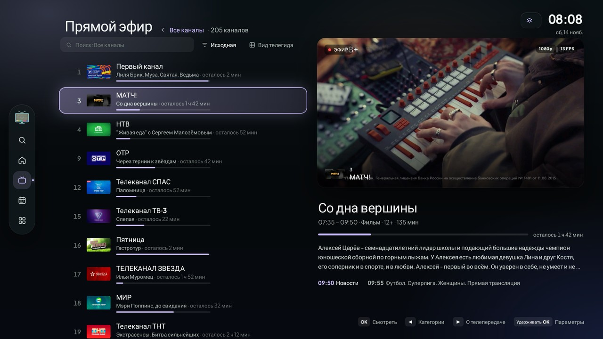
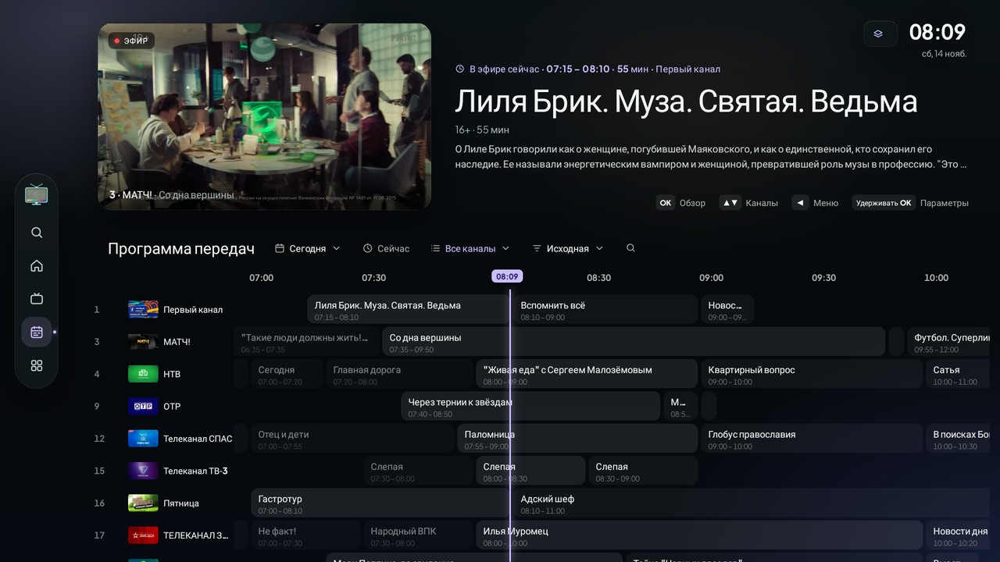
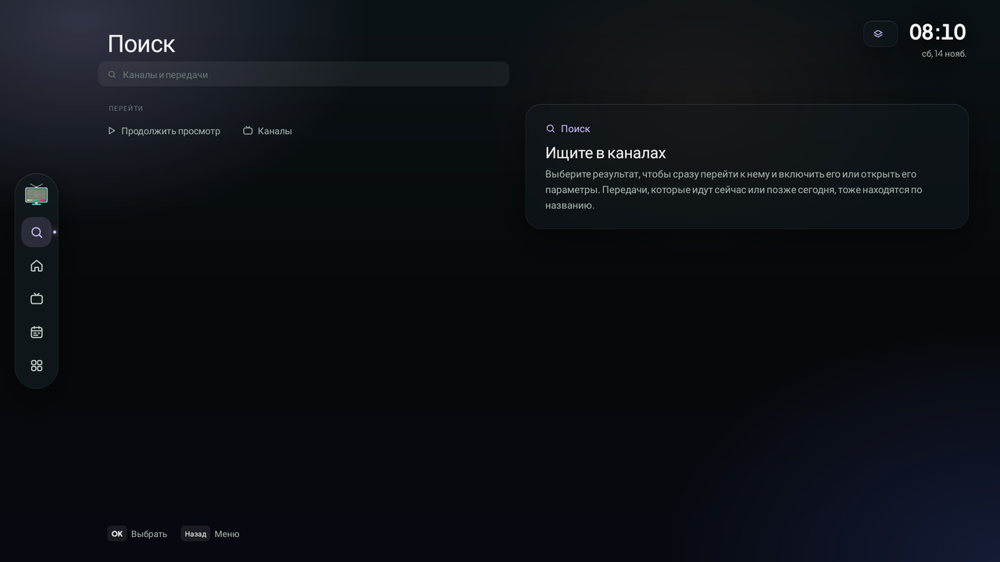
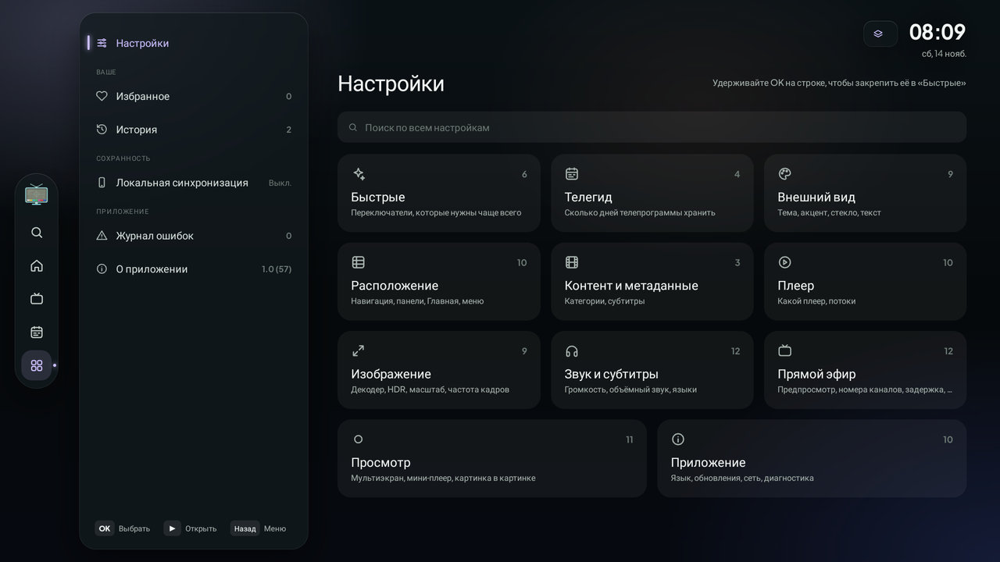

  <picture>
    <source media="(prefers-color-scheme: light)" srcset="extras/brand/app-logos/logo_eggshell_light.png">
    
  </picture>

<h1 align="center">МОЁ ТВ / MyOwnTV</h1>

  <b>Специализированный клиент RuTube для прямого эфира на Android TV</b> 
  Только онлайн-ТВ: каталог каналов и программа передач из публичного API RuTube — без плейлистов, логинов и собственных потоков

  
  
  

---

## О приложении

МОЁ ТВ — нативный плеер для Android TV, **заточенный исключительно под просмотр онлайн-тв RuTube**.
Список каналов (~300) и программа передач на неделю вперёд приходят из публичного API RuTube, эфир
воспроизводится через Media3 / ExoPlayer с почти мгновенным переключением каналов. Никаких плейлистов,
аккаунтов и собственных трансляций: для просмотра нужны только пульт и интернет.

> ⚠️ Приложение — **неофициальный клиент**. Оно не поставляет каналы, потоки и подписки, не аффилировано
> с RuTube (ООО «Руформ»). Ответственность за просмотр и соблюдение применимых законов лежит на зрителе.

## Возможности

- **Прямой эфир** — каталог RuTube с категориями, логотипами, живыми превью и быстрым переключением.
- **Телегид** — расписание на неделю, «сейчас» и «далее», напоминания о передачах. Расписание сохраняется
  по дням и обновляется upsert'ом, поэтому неудачное обновление не стирает уже загруженное.
- **Плеер** — 4K HDR без промежуточной обработки, необязательное автосогласование частоты кадров,
  объёмный звук, громкость до 150%, субтитры из потока, мини-плеер / PiP и режим «только звук».
  Корректные аудиофокус и медиасессия — приложение ведёт себя как телевизионное.
- **Навигация пультом (D-pad)** — избранное, скрытие каналов, поиск, PIN-код на категории.
- **Четыре языка интерфейса** — английский, русский, украинский, белорусский. Масштаб интерфейса и
  размер шрифта выбираются при первом запуске.

## Скриншоты

Снято на Android 13 (redroid, 1920×1080); на экранах с видео — живой эфир RuTube.

| | |
|:---:|:---:|
|  |  |
| **Онбординг** — язык и масштаб | **Эфир** — список каналов с превью |
|  |  |
| **Эфир** — воспроизведение | **Телегид** — сетка эфира |
|  |  |
| **Программа** — расписание на день | **Поиск** — по каналам и передачам |
|  |  |
| **Настройки** | **О приложении** |

Остальные экраны — в [docs/screenshots](docs/screenshots). Устройство API, правила для каналов и EPG:
[docs/rutube.md](docs/rutube.md).

## Системные требования

| | |
|---|---|
| **Платформа** | Android TV **6.0 (API 23)** или новее; Fire TV с лаунчером Leanback |
| **Управление** | Пульт с D-pad (навигация с пульта — основной сценарий) |
| **Процессор** | arm64-v8a или armeabi-v7a (32-битные Shield TV 2015/2017); x86_64 — только эмуляторы. Все три ABI — в одном APK |
| **Сеть** | Постоянный интернет: каталог и телегид грузятся из API RuTube, видео — из потока. Есть настройки прокси и DNS |
| **Размер** | Универсальный release-APK — около 7,4 МБ; дополнительно место под локальную базу каталога и EPG |

Приложение рассчитано в том числе на бюджетные приставки: запуск и предпросмотр адаптированы под слабое
железо. На старых версиях Android часть возможностей (например, PiP и автосогласование частоты кадров)
недоступна, но базовый просмотр работает без крешей. **Android 5.x и ниже не поддерживаются.**
Телефоны и планшеты без TV-лаунчера не являются целевой платформой.

## Установка

Релизы и страница загрузки:

- <https://dimzon.github.io/moe-tv-site/> — страница загрузки;
- <https://github.com/dimzon/moe-tv-site/releases> — APK.

Каждый релиз содержит **один универсальный APK** `MoeTV_<версия>_universal.apk` (arm64-v8a,
armeabi-v7a и x86_64 в одном файле). Установите его через **Downloader** на Fire TV, с USB-накопителя,
через *Send files to TV* или командой `adb install MoeTV_<версия>_universal.apk`. Встроенная проверка
обновлений («Настройки → О приложении») читает последний релиз из `dimzon/moe-tv-site`.

## Сборка

Сборка — **только батниками из корня репозитория** и **только флейвор `universal`**:

- `build-debug.cmd universal` — debug-сборка;
- `build-release.cmd universal` — release-сборка (R8, подпись из `keystore.properties`);
- `publish.cmd <версия> [notes.md]` — release-сборка + публикация релиза `v<версия>` в
  `dimzon/moe-tv-site` и обновление страницы загрузки.

Задачи `assemble*` через `gradlew` напрямую не запускать. APK — в `app/build/outputs/apk/universal/`.
Для запуска из Android Studio выберите вариант `universalDebug`. Стек: Kotlin 2.4.20, AGP 9.4.0,
Gradle 9.8.2, JDK 25, Jetpack Compose for TV, Room, Koin, OkHttp, Coil, Media3/ExoPlayer;
`minSdk 23`, `targetSdk 36`.

## Происхождение

**THIS IS A SUBSTANTIALLY MODIFIED VERSION OF OwnTV / Это существенно изменённая версия OwnTV.**
МОЁ ТВ создано на базе [OwnTV](https://github.com/ahXN00/OwnTV) и
[OwnTV_Core](https://github.com/ahXN00/OwnTV_Core) авторства ahXN00 и участников OwnTV
(GPL-3.0-only). Изменения вносятся с **09.11.2026** Дмитрием Александровым; Copyright (C) 2026
Dmitry Alexandrov — на изменения и дополнения, исходные части остаются © ahXN00 и участников OwnTV.
Это выделенное уведомление требуется GPLv3 §5(a). Приложение **не аффилировано, не одобрено и не
связано** с оригинальным OwnTV. Полное юридическое уведомление и список изменений — [NOTICE](NOTICE).

Исходный код: <https://github.com/dimzon/moe-tv>.

## Участие

Правки, сообщения об ошибках и идеи приветствуются — issue или pull request. Пожалуйста, сохраняйте
позиционирование проекта как «только плеер прямого эфира». Документация ведётся по-русски; подробности —
в [CONTRIBUTING.md](CONTRIBUTING.md).

## Лицензия

**GNU General Public License, версия 3 только (`GPL-3.0-only`)** — [LICENSE](LICENSE),
[NOTICE](NOTICE), [THIRD_PARTY_LICENSES.md](THIRD_PARTY_LICENSES.md). Как того требует GPLv3 §5(c),
вся производная работа лицензирована под GPLv3; дополнительных условий §7 не добавляется. Любая
распространяемая версия должна сохранять уведомления об авторских правах и предоставлять полные
**Соответствующие исходники** (§6) — они доступны в публичном репозитории выше. **ГАРАНТИИ НЕТ** (§§15–16).

## Бэкап ключей подписи

Release-ключ (`keystore/owntv-release.jks`) забэкапирован в приватном репозитории
**`dimzon/android-keystore-backup`** (файл `owntv-release.jks`, алиас, пароли и отпечаток — в `KEYS.md`
там же). Локально сборка по-прежнему берёт ключ из `keystore.properties` в корне проекта. Менять ключ,
алиас или пароль для уже опубликованного приложения нельзя — сломаются обновления.

---

МОЁ ТВ / MyOwnTV — неофициальный клиент RuTube, только прямой эфир. Существенно изменённая
производная работа OwnTV (© ahXN00 и участники OwnTV, GPL-3.0-only); изменения © 2026 Дмитрий
Александров, GPL-3.0-only.
