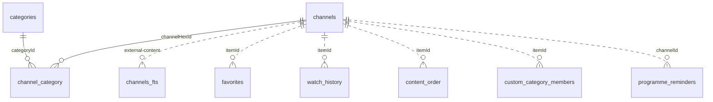

# Структура базы данных «МОЁ ТВ»

Документ описывает **физическую схему Room-базы** приложения: все таблицы, колонки, индексы,
внешние ключи, кто и когда их пишет/читает, и инварианты, на которых держится совместимость с
синхронизацией и бэкапами.

- Дата: 2026-11-13
- Класс: `tv.own.owntv.core.database.OwnTVDatabase`
- Файл БД: `/data/data/com.github.dimzon.owntv/databases/owntv.db`
- **Версия схемы: 8**, `identityHash = cc01942d3233ec82b58bab312c1b14b2`
- Экспортированная схема (источник истины для DDL): `app/schemas/tv.own.owntv.core.database.OwnTVDatabase/8.json`
- Конвертеры: `core/database/Converters.kt` — enum'ы (`MediaType`, `SourceType`,
  `TvProviderSurface`) хранятся как **имена** (`TEXT`), `Boolean` — как `INTEGER 0/1`

---

## 1. Как устроена база

### 1.1. Подключение

`core/di/DatabaseModule.kt`:

| Параметр | Значение | Зачем |
|---|---|---|
| Драйвер | `AndroidSQLiteDriver` (системный SQLite) | минус `libsqliteJni.so` (~2.6 МБ); `minSdk 26` → SQLite 3.18, поэтому в коде **не используются** UPSERT (3.24) и оконные функции (3.25) |
| Журнал | WAL (`WRITE_AHEAD_LOGGING` + проверка `PRAGMA journal_mode` в `onOpen`) | быстрые конкурентные чтения во время импорта каталога |
| `PRAGMA synchronous` | `NORMAL` | компаньон WAL: fsync на checkpoint, а не на каждый commit; выигрыш на eMMC при записи десятков тысяч строк |
| `PRAGMA cache_size` | `-8000` (≈8 МБ на соединение) | экраны перечитывают одни и те же индексные страницы |
| Миграции | `fallbackToDestructiveMigration(dropAllTables = true)` | в период редизайна установок нет: несовпадение схемы = пересоздание БД. **Строку нужно убрать до публичного релиза** |
| FK | включены Room по умолчанию | каскад `channel_category` работает |

### 1.2. Самовосстановление схемы (`healSchema`)

`OwnTVDatabase.healSchemaIfDrifted()` вызывается из `onOpen`:

1. дешёвый пробник — один `COUNT(*)` по `sqlite_master`;
2. если чего-то не хватает, `healSchema` идемпотентно создаёт недостающие **неуникальные** индексы
   из `EXPECTED_NON_UNIQUE_INDEXES` (только если все колонки индекса существуют) и, если не было
   external-content FTS-таблицы, создаёт её и наполняет через `rebuild`.

Причина: `BulkInsertHelper` на время массового импорта **дропает** неуникальные индексы и FTS-триггер,
а затем восстанавливает их из этого же списка. Прерванный импорт иначе оставил бы таблицу без
индексов — это невидимо до следующей полной валидации схемы Room, которая падает на старте.

Канонический набор неуникальных индексов (v8):

| Таблица | Индексы |
|---|---|
| `channels` | `index_channels_name`, `index_channels_sortOrder_name`, `index_channels_number` |
| `epg_programmes` | `index_epg_programmes_epgChannelId_startMs`, `index_epg_programmes_stopMs`, `index_epg_programmes_startMs_stopMs` |

Уникальные индексы сюда не входят осознанно: их никто никогда не дропает, а пересоздание
уникального индекса на неожиданных данных само может упасть. У `epg_programmes` уникальный
естественный ключ — `index_epg_programmes_natural_key (epgChannelId, startMs)`, Room создаёт его
сам (см. §6).

### 1.3. Bulk-импорт

`BulkInsertHelper.withOptimizedBulkInsert(table, …)` (`KNOWN_TABLES` = ключи
`EXPECTED_NON_UNIQUE_INDEXES`): первый писатель на пустую таблицу дропает неуникальные индексы и
FTS-триггер, последний — восстанавливает. `restoreIndexes` берёт **канонический** набор из
`OwnTVDatabase`, а не снимок `sqlite_master` (снимок сохранил бы уже существовавшую дыру).
Плюс `analyzeTables` для `categories` (ANALYZE без дропа).

---

## 2. Источник данных — не таблица

В схеме v5 **нет таблицы `sources`**. Единственный встроенный источник — RuTube — это DTO-синглтон:

- `core/repository/BuiltInSource.kt` — `object BuiltInSource` с `instance: SourceEntity`:
  захардкожены `id = 1`, `name = "RuTube"`, `type = RUTUBE`, `url = RutubeApi.BASE_URL`,
  `userAgent = RutubeApi.USER_AGENT`, `syncLive = true`.
- `SourceEntity` (`core/database/entity/SourceEntities.kt`) — обычный `data class`, **не** Room-сущность.
- Пользовательские значения, которые раньше жили в строке источника (пре-буфер, задержка эфира,
  «give up after», чистка имён, `lastSyncAt`), теперь **глобальные настройки** в DataStore
  (`SettingsRepository.sourcePreferences`); `SourceRepository.observeSources()` собирает из них
  `BuiltInSource.snapshot(...)` — так все прежние читатели `SourceEntity` работают без изменений.
  Значение, равное глобальному дефолту, отдаётся как «follow global» (`-1`/`null`), чтобы UI-счётчики
  переопределений оставались осмысленными.
- `SingleSource.id = 1L` — `const`, больше нигде не присваивается. Остался только как синоним
  `ChannelEntity.sourceId` и префикс ключей кастомизации; playback `contentKey` — уже просто hex.

Следствие: **ни одна таблица не хранит `sourceId`** и нет FK на источник. Схема v6 убрала и
`mediaType`: приложение live-only, поэтому дискриминатор типа контента тоже не нужен.

---

## 3. Карта таблиц

```
categories ──< channel_category >── channels
                                     │
                    channel_rename (без FK, hex-ключ)
                    channels_fts  (external content = channels)

Пользовательские данные (ключ — hex remoteId, без FK):
  favorites, watch_history (PK itemId+deviceId), content_order,
  custom_category_members, user_data_tombstones, programme_reminders,
  tv_provider_programs
  playback_prefs, playback_quirks (ключ — contentKey = hex remoteId)

EPG (без FK): epg_programmes
```

| Группа | Таблицы |
|---|---|
| Каталог RuTube | `categories`, `channels`, `channel_category`, `channel_rename`, `channels_fts` |
| Пользовательское | `favorites`, `watch_history`, `content_order`, `custom_category_members`, `user_data_tombstones`, `programme_reminders` |
| Плеер | `playback_prefs`, `playback_quirks` |
| EPG | `epg_programmes` |
| Android TV (спящая) | `tv_provider_programs` |



---

## 4. Каталог RuTube

### 4.1. `categories` — жанры провайдера

```sql
CREATE TABLE IF NOT EXISTS `categories` (
  `id` INTEGER PRIMARY KEY AUTOINCREMENT NOT NULL,
  `name` TEXT NOT NULL,
  `remoteId` TEXT,
  `sortOrder` INTEGER NOT NULL
);
CREATE UNIQUE INDEX IF NOT EXISTS `index_categories_remoteId` ON `categories` (`remoteId`);
```

| Колонка | Смысл |
|---|---|
| `name` | Название жанра как у провайдера |
| `remoteId` | id жанра у провайдера (nullable; в SQLite уникальный индекс допускает несколько `NULL`) |
| `sortOrder` | Порядок провайдера |

Схема v6 убрала `mediaType` (источник один, тип контента один): категория — просто `remoteId`.
Пишет: синк (`categoryRefresh`), `SyncSupport.pruneCategories` удаляет исчезнувшие.
Читает: `CategoryDao`, Customize. Видимость/замки/переименования категорий живут **не здесь**, а в
DataStore (см. §8); строка `categories` — только данные провайдера.

### 4.2. `channels` — канал (5 физических колонок)

```sql
CREATE TABLE IF NOT EXISTS `channels` (
  `remoteId` TEXT NOT NULL,
  `name` TEXT NOT NULL,
  `logoUrl` TEXT,
  `number` INTEGER,
  `sortOrder` INTEGER NOT NULL,
  PRIMARY KEY(`remoteId`)
);
CREATE INDEX IF NOT EXISTS `index_channels_name` ON `channels` (`name`);
CREATE INDEX IF NOT EXISTS `index_channels_sortOrder_name` ON `channels` (`sortOrder`, `name`);
CREATE INDEX IF NOT EXISTS `index_channels_number` ON `channels` (`number`);
```

| Колонка | Смысл |
|---|---|
| `remoteId` | **Естественный ключ**: 16-байтовый hex `videoId` RuTube (32 символа), PK |
| `name` | Отображаемое имя; при дублях имени — «Имя · уточнение»; после синка перезаписывается словарём `channel_rename` |
| `logoUrl` | Логотип провайдера |
| `number` | Номер канала у провайдера (`order_number`; `999` = «номера нет» → `NULL`) |
| `sortOrder` | Позиция в отсортированной выдаче: по `order_number` (999 — в конец), затем по имени |

Код-уровневые синонимы (в БД их **нет**, это геттеры `ChannelEntity`):

| Синоним | Значение |
|---|---|
| `id` | `remoteId` |
| `epgChannelId` | `remoteId` — hex сам служит guide-id: при одном источнике отдельного EPG-клю­ча нет |
| `streamUrl` | `"rutube://$remoteId"` |
| `sourceId` | `SingleSource.id` (константа 1) |
| `catchup`, `catchupDays`, `catchupSource`, `catchupType`, `catchupCorrectionMin` | `false` / `0` / `null` (live-only) |
| `httpHeaders`, `drmConfig`, `manifestType`, `directSource`, `providerName` | `null` |
| `isPaid` | `false` (платные каналы отфильтрованы на синке) |
| `matchName` | `providerName ?: name` → всегда `name` |

Пишут: `SyncSupport.upsertChannels()` — `upsertAll` (REPLACE по PK) чанками;
`ChannelRenameDao.applyToChannels()` — UPDATE имён; `SyncSupport.pruneChannels()` — удаление
исчезнувших (под защитой catalog-shrink guard). Пересинхронизация **не меняет ключ**, поэтому
пользовательские данные на hex не «отвязываются».

### 4.3. `channel_category` — M:N канал ↔ жанр

```sql
CREATE TABLE IF NOT EXISTS `channel_category` (
  `channelHexId` TEXT NOT NULL,
  `categoryId` INTEGER NOT NULL,
  PRIMARY KEY(`channelHexId`, `categoryId`),
  FOREIGN KEY(`channelHexId`) REFERENCES `channels`(`remoteId`) ON DELETE CASCADE,
  FOREIGN KEY(`categoryId`) REFERENCES `categories`(`id`) ON DELETE CASCADE
);
CREATE INDEX IF NOT EXISTS `index_channel_category_categoryId` ON `channel_category` (`categoryId`);
CREATE INDEX IF NOT EXISTS `index_channel_category_channelHexId` ON `channel_category` (`channelHexId`);
```

Один канал состоит во всех жанрах, где вещает (`broadcast_category[]`). Каждый синк таблица
пересобирается целиком: `clearAll()` → отбор только по реально существующим `presentHexIds()` →
`insertAll(...)` (жанровый id `1` — «все live» — не линкуется, это зеркало «Всё», а не полка).
Читается снимком `ChannelMembership.observeAll()` — in-memory карта `hexId → Set<categoryId>` для
фильтров видимости (скрытые/запертые категории), чтобы не делать запрос на строку.

### 4.4. `channel_rename` — курируемый словарь имён

```sql
CREATE TABLE IF NOT EXISTS `channel_rename` (
  `remoteId` TEXT NOT NULL,
  `name` TEXT NOT NULL,
  PRIMARY KEY(`remoteId`)
);
```

Без FK намеренно: переименование **переживает** удаление канала и пересоздание строки; осиротевшая
запись инертна, вернувшийся канал снова получит имя.

Источник — `app/src/main/assets/channel_renames.json` (плоский `{ hex: name }`), загружается
`ChannelRenameSeeds`; на каждом синке `ChannelRenameDao.replaceAll()` зеркалит словарь целиком
(записи, выпавшие из новой сборки, исчезают), затем `applyToChannels()` переписывает `channels.name`.
Пользовательские переименования из Customize хранятся в DataStore и применяются поверх.

### 4.5. `channels_fts` — полнотекстовый поиск

```sql
CREATE VIRTUAL TABLE IF NOT EXISTS `channels_fts`
  USING FTS4(`name` TEXT NOT NULL, content=`channels`);
```

External-content FTS4 только по `name`; триггеры синхронизации создаёт Room. Поиск в `ChannelDao`
идёт подзапросом `rowid IN (SELECT rowid FROM channels_fts WHERE …)` (rowid — это rowid `channels`,
не `remoteId`). `healSchema` пересоздаёт таблицу и делает `rebuild`, если её не было.

---

## 5. Пользовательские данные

Общее правило: ключ — **hex `remoteId`** (стабильный навсегда); `mediaType` из схемы удалён в v6.
FK нет: чистка выполняется явно в repository-слое после синка
(`DELETE … WHERE itemId NOT IN (SELECT remoteId FROM channels)`), чтобы housekeeping никогда не
писал tombstone и не каскадил удаление пользовательских строк.

### 5.1. `favorites`

```sql
CREATE TABLE IF NOT EXISTS `favorites` (
  `itemId` TEXT NOT NULL,
  `addedAt` INTEGER NOT NULL,
  PRIMARY KEY(`itemId`)
);
```

Схема v7: нет суррогатного `id` — hex `itemId` сам первичный ключ.
`addedAt` — LWW-штамп: apply локальной синхронизации двигает его только вперёд
(`bumpIfNewer`), удаление с другого устройства применяется лишь к строке не новее (`removeIfOlderThan`).
`purgeOrphans()` вызывается в `afterSync` и удаляет строки, чьего канала больше нет.

### 5.2. `watch_history`

```sql
CREATE TABLE IF NOT EXISTS `watch_history` (
  `itemId` TEXT NOT NULL,
  `watchedAt` INTEGER NOT NULL,
  `deviceId` TEXT NOT NULL,
  PRIMARY KEY(`itemId`, `deviceId`)
);
CREATE INDEX IF NOT EXISTS `index_watch_history_watchedAt` ON `watch_history` (`watchedAt`);
```

Схема v6: **одна строка на элемент на устройство**, PK `(itemId, deviceId)`, без суррогатного `id`.
`deviceId` — хеш `DeviceIdentity.id` устройства-писателя; `""` — id не прочитался (это значение
ключа, не «другое устройство»). Списки (Favorites/History/«недавно смотрели») сворачивают устройства
через `GROUP BY itemId` + `MAX(watchedAt)`; счётчики считают `DISTINCT itemId`.

### 5.3. `content_order` — ручной порядок списков

```sql
CREATE TABLE IF NOT EXISTS `content_order` (
  `id` INTEGER PRIMARY KEY AUTOINCREMENT NOT NULL,
  `contextKey` TEXT NOT NULL,
  `itemId` TEXT NOT NULL,
  `position` INTEGER NOT NULL,
  `updatedAt` INTEGER NOT NULL DEFAULT 0
);
CREATE INDEX IF NOT EXISTS `index_content_order_contextKey` ON `content_order` (`contextKey`);
CREATE UNIQUE INDEX IF NOT EXISTS `index_content_order_contextKey_itemId`
  ON `content_order` (`contextKey`, `itemId`);
```

`contextKey`:

| Значение | Что это |
|---|---|
| `__fav__` (`ContentOrderEntity.FAV_CONTEXT`) | порядок внутри «Избранного» |
| `<sourceId>:<remoteId или name>` (`CustomizeKeys.category`) | порядок внутри папки-категории (sourceId — константа 1) |
| `custom:<uuid>` (`CustomizeKeys.CUSTOM_PREFIX`) | порядок внутри пользовательской составной категории |

Хранятся **только сдвинутые пользователем** элементы (pinned positions); остальные продолжают
следовать за сортировкой вокруг них. `updatedAt` — LWW-штамп для синхронизации (`0` = строка без
штампа, вставляется при отсутствии, но никогда не побеждает штампованную).

### 5.4. `custom_category_members` — состав пользовательских категорий

```sql
CREATE TABLE IF NOT EXISTS `custom_category_members` (
  `id` INTEGER PRIMARY KEY AUTOINCREMENT NOT NULL,
  `contextKey` TEXT NOT NULL,
  `itemId` TEXT NOT NULL,
  `position` INTEGER NOT NULL
);
CREATE INDEX IF NOT EXISTS `index_custom_category_members_contextKey`
  ON `custom_category_members` (`contextKey`);
CREATE UNIQUE INDEX IF NOT EXISTS `index_custom_category_members_contextKey_itemId`
  ON `custom_category_members` (`contextKey`, `itemId`);
```

Здесь лежит именно **состав** (какие элементы входят) и порядок вставки (`position`). Порядок,
изменённый Move, как и везде, пишется в `content_order` с тем же `contextKey`; browse-запрос
категории делает `LEFT JOIN` обеих таблиц. Определение самой категории (имя, порядок в рельсе) —
в DataStore.

Членство входит в снапшот бэкапа (`member`), но **не** ездит в локальной синхронизации между
устройствами — там только `fav`/`order`/`his`/`prog` (`SyncMatrix.KINDS`). При пересинхронизации
на этом же устройстве строки не перепривязываются: hex-ключ стабилен, а `afterSync` только чистит
осиротевшие.

### 5.5. `user_data_tombstones` — надгробия удалений

```sql
CREATE TABLE IF NOT EXISTS `user_data_tombstones` (
  `id` INTEGER PRIMARY KEY AUTOINCREMENT NOT NULL,
  `kind` TEXT NOT NULL,
  `identity` TEXT NOT NULL,
  `deletedAt` INTEGER NOT NULL
);
CREATE UNIQUE INDEX IF NOT EXISTS `index_user_data_tombstones_kind_identity`
  ON `user_data_tombstones` (`kind`, `identity`);
CREATE INDEX IF NOT EXISTS `index_user_data_tombstones_deletedAt`
  ON `user_data_tombstones` (`deletedAt`);
```

`kind`: `fav`, `order`, `prog` — только эти удаления ездят между устройствами.
`identity` — **не** `itemId`, а канонический стабильный ключ (JSON: provider id, name /
show+season+episode), чтобы удаление было узнаваемо на устройстве с другими id.
Пишутся только реальные действия пользователя; housekeeping-пуржи после синка надгробий не пишут.

### 5.6. `programme_reminders` — напоминания о передачах

```sql
CREATE TABLE IF NOT EXISTS `programme_reminders` (
  `id` INTEGER PRIMARY KEY AUTOINCREMENT NOT NULL,
  `channelId` TEXT NOT NULL,
  `title` TEXT NOT NULL,
  `startMs` INTEGER NOT NULL,
  `stopMs` INTEGER NOT NULL,
  `leadMinutes` INTEGER NOT NULL,
  `createdAt` INTEGER NOT NULL,
  `updatedAt` INTEGER NOT NULL DEFAULT 0
);
CREATE INDEX IF NOT EXISTS `index_programme_reminders_startMs`
  ON `programme_reminders` (`startMs`);
CREATE UNIQUE INDEX IF NOT EXISTS `index_programme_reminders_channelId_startMs`
  ON `programme_reminders` (`channelId`, `startMs`);
```

Одно напоминание на передачу канала (повторное нажатие обновляет). `channelId` — hex и единственная
идентичность строки; `channelName`/`epgChannelId` удалены в v6. Живёт часы/дни: `stopMs <= now`
вычищается. В локальной синхронизации и бэкапе ездит как `prog` с identity `(channelId, startMs)`.

### 5.7. `tv_provider_programs` — зеркало Android TV (спящая)

```sql
CREATE TABLE IF NOT EXISTS `tv_provider_programs` (
  `id` INTEGER PRIMARY KEY AUTOINCREMENT NOT NULL,
  `surface` TEXT NOT NULL,
  `groupId` INTEGER NOT NULL,
  `targetItemId` TEXT NOT NULL,
  `providerProgramId` INTEGER,
  `lastPositionMs` INTEGER NOT NULL,
  `durationMs` INTEGER NOT NULL,
  `lastEngagementAt` INTEGER NOT NULL,
  `lastPublishedAt` INTEGER NOT NULL
);
CREATE UNIQUE INDEX IF NOT EXISTS `index_tv_provider_programs_surface_groupId`
  ON `tv_provider_programs` (`surface`, `groupId`);
```

`surface`: `WATCH_NEXT`, `RECENT_LIVE`. `groupId` — стабильный хеш identity контента, чтобы строка
канала могла «перерасти» в следующий эпизод, не меняя локальную identity.
**В live-only приложении таблица спит:** DAO зарегистрирован в Koin, но production-вызовов записи и
чтения сейчас нет — оставлена в схеме для будущего возврата интеграции с домашним экраном.

### 5.8. `playback_prefs` — предпочтения пользователя на элемент

```sql
CREATE TABLE IF NOT EXISTS `playback_prefs` (
  `contentKey` TEXT NOT NULL,
  `zoomMode` TEXT,
  `volumeBoost` INTEGER,
  `updatedAt` INTEGER NOT NULL,
  `audioLang` TEXT,
  `subtitleLang` TEXT,
  PRIMARY KEY(`contentKey`)
);
```

`contentKey` = hex `remoteId` (fallback — URL для строк без provider id). Все настройки nullable:
`null` = «следовать глобальной настройке», и строки нет, пока пользователь ничего не менял.
`subtitleLang = ""` = субтитры выключены. Колонка `audioDelayMs` удалена в v6: задержка живёт в
`playback_quirks`.

### 5.9. `playback_quirks` — факты о потоке

```sql
CREATE TABLE IF NOT EXISTS `playback_quirks` (
  `contentKey` TEXT NOT NULL,
  `audioOnly` INTEGER,
  `audioDelayMs` INTEGER,
  `updatedAt` INTEGER NOT NULL,
  PRIMARY KEY(`contentKey`)
);
```

Отдельно от `playback_prefs`: это свойство **потока** и выхода устройства (audio-only, липсинк), а не
предпочтение человека. Схема v6 убрала `mediaType` и `sourceId`: остались только факты о потоке.

---

## 6. EPG

### 6.1. Где живёт гид

Схема v8 удалила `epg_channels`. При одном источнике guide-id канала — это его hex `remoteId`
(`ChannelEntity.epgChannelId` — геттер `remoteId`), поэтому отдельный реестр гида только дублировал
каталог, причём **худшими** именами: сырыми `author.name` до словаря `channel_rename` и до
дизамбигуации дублей. Теперь:

- имена и логотипы гид берёт из `channels` (`ChannelDao.guideChannelNames`);
- наличие программ — из `epg_programmes` (`EpgDao.guideProgrammeChannelIds`);
- обе половины сводит `GuideCandidates` — общий источник для пикера «Match EPG» и авто-матча.

FK нет ни у одной EPG-таблицы.

### 6.2. `epg_programmes` — передачи

```sql
CREATE TABLE IF NOT EXISTS `epg_programmes` (
  `id` INTEGER PRIMARY KEY AUTOINCREMENT NOT NULL,
  `epgChannelId` TEXT NOT NULL,
  `startMs` INTEGER NOT NULL,
  `stopMs` INTEGER NOT NULL,
  `title` TEXT NOT NULL,
  `subtitle` TEXT,
  `description` TEXT,
  `category` TEXT,
  `ageRating` TEXT,
  `iconUrl` TEXT
);
CREATE UNIQUE INDEX IF NOT EXISTS `index_epg_programmes_natural_key`
  ON `epg_programmes` (`epgChannelId`, `startMs`);
CREATE INDEX IF NOT EXISTS `index_epg_programmes_stopMs` ON `epg_programmes` (`stopMs`);
CREATE INDEX IF NOT EXISTS `index_epg_programmes_startMs_stopMs`
  ON `epg_programmes` (`startMs`, `stopMs`);
```

| Колонка | Смысл |
|---|---|
| `epgChannelId` | hex `remoteId` канала — guide-ключ |
| `startMs` / `stopMs` | окно эфира |
| `title` | название передачи |
| `subtitle` | вторая строка эфира; часто эпизод («Сезон 2 Серия 17», «Выпуск 3») |
| `description` | синопсис |
| `category` | `ext_categories[0].name` — ровно один жанр |
| `ageRating` | `ageRating` (pangolin/бриф) или `age_rating` (mobile) как есть: `16+`, `12+`, `0+` |
| `iconUrl` | `preview_picture_url` — арт передачи 600×450 |

Естественный ключ — `(epgChannelId, startMs)`; запись `writeBrief`/`writeChannel` — REPLACE чанками
по 500. Бриф (`tvprogramm=true`) пишет now/next с `title`/`subtitle`/`description`/`ageRating`;
сетка pangolin затем REPLACE-ит те же строки, добавляя `category`/`iconUrl`.

Схема v8 привела таблицу ровно к тому, что публикует API: `year`, `episode`, `lengthMin`,
`contentHash` удалены. Года и номера эпизода RuTube не отдаёт вовсе; длина выводится из
`stopMs − startMs` и показывается в details-строке, а не хранится. Для сравнения: бриф — тот же
эндпоинт `tvbroadcastinfo`, что и каталог, только с `tvprogramm=true` (отличается лишь `title`).

Ретенция: `prune(stopMs < now − 2 дня)` после каждого EPG-синка. `pruneFuture(startMs > after)` —
для горизонта «сколько дней телепрограммы хранить»; в текущем коде вызов не подключён (настройка
пока только сужает окно отображения в `EpgViewModel`).

Привязка «канал → epgChannelId» **в БД не хранится** — это `epgMatches` в DataStore (см. §8).

---

## 7. Инварианты

1. **Hex — единственный стабильный id.** `channels.remoteId` (32-символьный hex `videoId`) — PK;
   все пользовательские таблицы ключуются им. Пересинхронизация делает REPLACE по PK, поэтому ключ
   не может «съехать», и отдельного relink/capture-прохода в коде нет.
2. **Ни источника, ни типа контента в БД нет.** `sources` удалена в v5, `mediaType` — в v6;
   `BuiltInSource` — захардкоженный DTO-синглтон, его изменяемые значения — глобальные настройки.
3. **Purge-контракт.** После синка `SourceRepository.sync` вызывает `UserDataResolver.afterSync(purge)`,
   который удаляет строки пользовательских таблиц, чей канал исчез. Удаление housekeeping'ом не
   пишет tombstone.
4. **Каскады только в каталоге.** FK с `CASCADE` есть только у `channel_category`
   (→ `channels`/`categories`). Пользовательские таблицы FK не имеют намеренно.
5. **Бэкап и локальная синхронизация** сериализуют пользовательские данные через стабильные ключи
   (hex / canonical identity JSON), а не через локальные `id` строк. Локальная синхронизация несёт
   `fav`/`order`/`his`/`prog`; бэкапный снапшот — те же `prog`-напоминания плюс `member`
   (состав пользовательских категорий).
6. **Схема самовосстанавливается** на каждом открытии; ожидаемый набор индексов/FTS — в
   `OwnTVDatabase.EXPECTED_NON_UNIQUE_INDEXES` / `EXPECTED_FTS_TABLES`. Любое будущее изменение
   финальной схемы обязано сохранить работу `healSchema`.
7. **Деструктивная миграция** — временная мера периода редизайна (`fallbackToDestructiveMigration`),
   не продакшн-политика.

---

## 8. Что живёт НЕ в Room

Часть состояния, которое влияет на «данные БД», хранится в DataStore (`customizeStore` и настройки) —
это осознанно, чтобы не плодить схему и переживать пересоздание каталога:

| Данные | Ключ/формат | Почему не таблица |
|---|---|---|
| Скрытые/переименованные/переупорядоченные категории и элементы, замки категорий | JSON `cust_LIVE` (`SectionCustomizations`) | переживает пересинк по stable-keys |
| Определения пользовательских категорий (имя, порядок) | JSON в том же `cust_*` | — |
| `epgMatches` — ручные/авто-привязки канал → `epgChannelId` | map stable-key → epg id + `EpgMatchResolver` (3 уровня: точный ключ → tail по любому источнику → нормализованное имя) | бэкап уже экспортирует map; перенос в Room отвергнут |
| Параметры единственного источника: пре-буфер, задержка эфира, «give up after», чистка имён | глобальные ключи `live_preroll_secs`, `live_latency_*`, `live_tune_timeout_secs`, `channel_cleanup_*` | это пользовательские настройки, а не данные каталога |
| `lastSyncAt` каталога | `source_last_sync_at` | факт о устройстве; им живут fresh-import и автообновление |
| Признак «стартовый канал», последний канал, настройки | `LAST_LIVE_CHANNEL`, `StartupChannelRef` JSON и пр. | настройки, не данные |

Ключи кастомизации имеют вид `<sourceId>:<remoteId|name>` (`CustomizeKeys.channel/category`), где
`sourceId` — константа `SingleSource.id`.

---

## 9. История версий схемы (эпоха live-only)

Старая история 1 → 57 удалена вместе с профилями; сброс на v1. Журнал прежних версий остался в
git history и `CHANGELOG.md`.

| Версия | Изменение |
|---|---|
| 1 | Сброс схемы после live-only редизайна: профилей нет, миграции 1–57 удалены; БД пересоздаётся |
| 2 | Удалена `channels.categoryId`; членство канала в жанрах — M:N `channel_category` |
| 3 | Добавлена `channel_rename` (hex → имя, без FK), зеркалится из `assets/channel_renames.json` на каждом синке |
| 4 | **`channels` сдута до натурального ключа:** `remoteId` — PK; удалены `id`, `sourceId`, `streamUrl`, `epgChannelId`, `catchup*`, `httpHeaders`, `drmConfig`, `manifestType`, `directSource`, `contentHash`, `providerName`, `isPaid` (живут как геттеры-синонимы). Удалена hash-diff/stable-upsert машинерия; синк — REPLACE по PK |
| 5 | **Таблицы `sources` больше нет:** единственный источник — DTO-синглтон `BuiltInSource`, его настройки — глобальные настройки DataStore. `sourceId` удалён из `categories`, `epg_channels`, `epg_programmes`, `playback_prefs`, `playback_quirks`. Удалён `SourceDao` |
| 6 | **Удалён `mediaType` из всех таблиц** (live-only): `categories` → уникальный `remoteId`, `favorites` → уникальный `itemId`, `content_order`/`custom_category_members` → `(contextKey, itemId)`, `playback_quirks` и `tv_provider_programs` без типа. `watch_history` — PK `(itemId, deviceId)`, без `id`; `deviceId` NOT NULL. `programme_reminders` теряет `channelName`/`epgChannelId`. Удалена legacy-колонка `playback_prefs.audioDelayMs` |
| 7 | **`favorites` без суррогатного `id`:** hex `itemId` — PK (уникальный индекс больше не нужен) |
| 8 | **`epg_channels` удалена**; `epg_programmes` приведена к полям RuTube: добавлены `subtitle`, `category`, `ageRating`, `iconUrl`, удалены `year`, `episode`, `lengthMin`, `contentHash`. Guide-ключ = `channels.remoteId`, имена гида — из каталога |

---

## 10. Как проверить на устройстве

```bash
# схема
adb shell run-as com.github.dimzon.owntv sqlite3 databases/owntv.db 'pragma table_info(channels);'
# объёмы
adb shell run-as com.github.dimzon.owntv sqlite3 databases/owntv.db \
  'select count(*) from channels; select count(*) from channel_category; select count(*) from channel_rename;'
# источников нет, sourceId нигде нет
adb shell run-as com.github.dimzon.owntv sqlite3 databases/owntv.db \
  "select count(*) from sqlite_master where type='table' and name='sources'; pragma table_info(categories);"
```

Ожидаемо для текущего каталога: 5 колонок `channels`, 205 каналов, 382 строки `channel_category`,
68 строк `channel_rename`, `sources` — 0 таблиц, `mediaType`/`sourceId` нет ни в одной таблице,
`watch_history` — 3 колонки с PK `(itemId, deviceId)`, индексы `index_channels_name` /
`index_channels_sortOrder_name` / `index_channels_number`. Таблицы `epg_channels` нет; у
`epg_programmes` 10 колонок (`id`, `epgChannelId`, `startMs`, `stopMs`, `title`, `subtitle`,
`description`, `category`, `ageRating`, `iconUrl`).

Схема-эталон для диффа: `app/schemas/tv.own.owntv.core.database.OwnTVDatabase/8.json` — любое
изменение сущностей Room обязано менять этот файл (он коммитится вместе с кодом).
